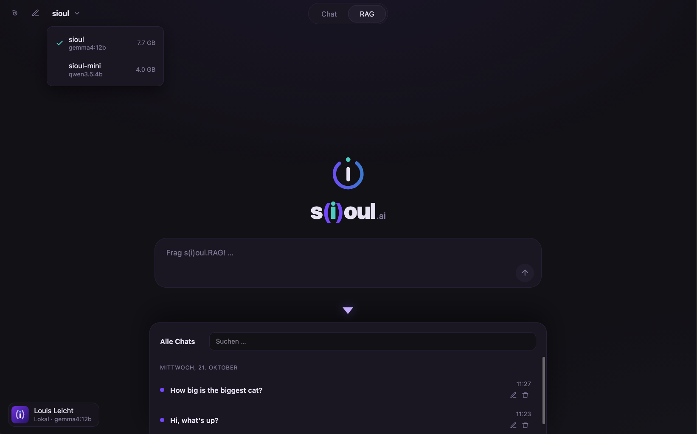

# s(i)oul.local

Ein vollständig lokaler KI-Chat mit eigenem Interface. S(i)oul nutzt ein
Open-Weight-Modell, das direkt auf deinem Rechner läuft. Über RAG
(Retrieval-Augmented Generation) beantwortet es Fragen auf Basis eigener
Dokumente. Es braucht keine Internetverbindung und keinen API-Key, und
deine Daten verlassen nie dein Gerät.

## Features
- 💬 Selbstgebautes Chat-Interface
- 📚 RAG über eigene Textdateien im Ordner `data/`, mit Quellenangabe
- 🔒 100 % lokal und offline nutzbar
- ⚖️ Zwei Modellgrößen zur Auswahl
- 🎙️ Spracheingabe (Whisper) und Vorlesen der Antworten (Piper), Deutsch und Englisch
- 🤖 Agent-Modus: Das Modell entscheidet selbst, ob es in den Dokumenten sucht
  oder eine App öffnet (selbst gebaute Tool-Schleife, kein Framework)
- 🖥️ Als Web-Anwendung im Browser oder als eigene Mac-App mit Icon im Dock

Getestet auf einem MacBook Air M2 mit 16 GB RAM. Beide Modelle laufen dort
problemlos.



Weitere Screenshots liegen im Ordner [`Einblicke/`](Einblicke/).

## Voraussetzungen

- [Python 3.12](https://www.python.org/downloads/)
- [Docker Desktop](https://www.docker.com/products/docker-desktop/) (für Qdrant)
- [Ollama](https://ollama.com/download)

Getestet auf macOS. Die `.command`-Skripte zum Starten per Doppelklick
funktionieren nur auf macOS. Unter Linux und Windows startest du das Projekt
manuell (siehe [Zum Entwickeln](#zum-entwickeln-änderungen-sofort-live)).

## Installation

```bash
git clone https://github.com/sioullht/sioul-local.git
cd sioul-local

# Python-Pakete
python3.12 -m pip install -r requirements.txt

# Modelle für Ollama
ollama pull gemma4:12b          # größeres Sprachmodell -> 'sioul'
ollama pull qwen3.5:4b          # kleineres Sprachmodell -> 'sioul-mini'
ollama pull nomic-embed-text    # Embeddings für die Suche

# Eigene Modelle mit s(i)oul-Persönlichkeit anlegen
ollama create sioul -f modelfiles/Modelfile
ollama create sioul-mini -f modelfiles/Modelfile.mini
```

> **Hinweis:** In der Modellauswahl erscheinen bevorzugt die Modelle `sioul` und `sioul-mini`.
> Die Modelfiles in `modelfiles/` legen dafür das Basismodell und einen kurzen System-Prompt fest.
> Fehlen die Modelle, zeigt die Auswahl automatisch alle installierten Chat-Modelle an.

## Starten & stoppen

```bash
./start.command   # startet Ollama, Qdrant und den Server, öffnet den Browser
./stop.command    # stoppt Server und Qdrant (Ollama läuft weiter)
```

Oder einfach im Finder doppelklicken.

Adresse: http://localhost:3001

Beim ersten Start werden alle `.txt`-Dateien aus `data/` eingebettet und in Qdrant gespeichert (dauert ein paar Sekunden).
Danach wird dieser Schritt übersprungen.

Beim ersten Start werden außerdem die Sprachmodelle für Whisper und Piper
(~600 MB) in den Ordner `models/` geladen. Dafür wird einmal Internet gebraucht,
danach funktionieren Spracheingabe und Vorlesen offline.

## Als Mac-App (ohne Browser und ohne Docker)

```bash
./build_app.command   # erzeugt dist/s(i)oul.app
```

Die App in den Programme-Ordner ziehen und von dort ins Dock. Ein Klick startet
Ollama (falls nötig), Qdrant und den Server und öffnet s(i)oul in einem eigenen
Fenster. Beim Schließen wird alles wieder beendet.

- Qdrant läuft in der App ohne Docker und speichert in `qdrant_data/`.
- Die App nutzt Port 3002, die Web-Version 3001.
- Die App ist eine **Verweis-App**: Sie startet `desktop.py` aus diesem Ordner.
  Code-Änderungen wirken sofort. Nur neu bauen, wenn der Projektordner verschoben wird
  oder sich `setup.py` bzw. das Icon ändert.
- Ohne zu bauen geht es auch mit `python3.12 desktop.py`.
- Log-Datei: `~/Library/Logs/sioul.log`

## Zum Entwickeln (Änderungen sofort live)

```bash
docker compose up -d qdrant
python3.12 -m uvicorn server:app --port 3001 --reload
```

### Qdrant ohne Docker

Statt im Docker-Container kann Qdrant auch direkt in Python laufen und seine
Daten in einem Ordner speichern. Dafür die Umgebungsvariable `QDRANT_PATH` setzen:

```bash
QDRANT_PATH=qdrant_data python3.12 -m uvicorn server:app --port 3001 --reload
```

Dann darf immer nur ein Programm gleichzeitig auf den Ordner zugreifen
(also nicht Server und `agent.py` parallel). Ohne `QDRANT_PATH` wird wie bisher
der Docker-Container genutzt.

## Was läuft wo

| Teil | Wo | Aufgabe |
|---|---|---|
| Ollama | lokal | Modelle (nomic-embed-text, gemma4:12b, sioul …) |
| Qdrant | Docker | Dokumente aus `data/` als Vektoren |
| server.py + index.html | lokal | Interface und API |
| chats.db | Datei im Ordner | Chat-Verlauf (SQLite, wird automatisch angelegt) |
| models/ | Ordner im Projekt | Whisper- und Piper-Modelle (~600 MB, beim ersten Start geladen) |

## Dateien

- `ownRAG.py` – Einbetten, Suchen, Terminal-Chatbot (`python3.12 ownRAG.py`)
- `server.py` – API für die Webseite
- `agent.py` – Agent-Schleife mit Tool-Calling (`python3.12 agent.py` für den Terminal-Agent)
- `tools.py` – Tools des Agents: Dokumente durchsuchen, Dateien lesen, Uhrzeit, Apps öffnen
- `desktop.py` – Mac-App: startet den Server und öffnet ein eigenes Fenster
- `setup.py`, `build_app.command` – bauen `s(i)oul.app`
- `voice.py` – Spracheingabe (Whisper) und Vorlesen (Piper)
- `index.html` – Interface
- `data/` – Textdateien für den RAG-Modus (Beispiel: `sioul.txt`)
- `modelfiles/` – Modelfiles für `sioul` und `sioul-mini`
- `requirements.txt` – benötigte Python-Pakete
- `docker-compose.yml` – Qdrant-Container

## RAG: eigene Dokumente verwenden

Der Ordner `data/` lässt sich beliebig um eigene `.txt`-Dateien erweitern,
sodass das RAG auf weitere Daten zugreifen kann. Jede Zeile wird ein eigener
Abschnitt, also am besten eine Aussage pro Zeile. Als Beispiel liegt
`data/sioul.txt` bei, mit Fakten über dieses Projekt.

Ist Qdrant schon befüllt, leere die Collection einmal, damit die neuen Dateien
beim nächsten Start eingelesen werden:

```bash
curl -X DELETE http://localhost:6333/collections/documents
```

## Lizenz

[MIT](LICENSE)
